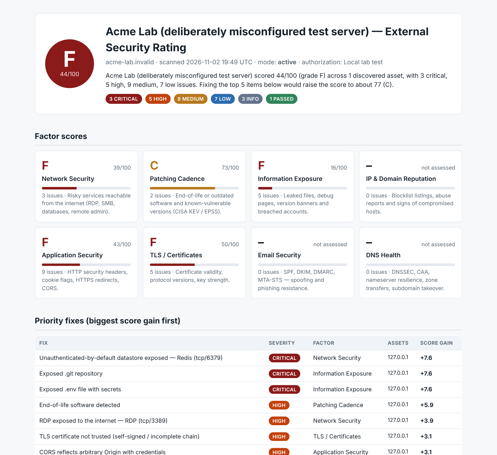

<h1 align="center">
  <picture>
    <source media="(prefers-color-scheme: dark)" srcset="docs/brand/openscore-logo-dark.svg">
    
  </picture>
</h1>

<p align="center"><em>The attacker's view, open to everyone.</em></p>

**A free, open-source external security rating, with remediation steps and false-positive handling.**

OpenScore looks at an organization from the outside, the way an attacker would, and grades it A–F across eight factors:

- every point is explained,
- every finding comes with a fix and a command to verify it, and
- false positives can be triaged and recorded instead of argued about.

## Why OpenScore exists

Attackers don't pay to find your weaknesses. Free scanners, search engines like
Shodan, and public certificate logs show them exposed services, missing patches
and misconfigured email in minutes.

Defenders often have to pay for the same view, through subscriptions that many
small businesses, nonprofits, schools and local governments can't afford, even
though they're targeted just as often and have the fewest people to respond.

OpenScore closes that gap. Any organization can see what an attacker sees from
the outside, understand why each issue matters, and get clear steps to fix and
verify it, all for free. Knowing about these issues shouldn't depend on budget.

## Who it's for

OpenScore is a purple-team tool: one outside-in assessment, with evidence both sides can use.

- **Defenders and IT teams:** see your organization's external exposure the way an attacker
  would, track the score over time, and triage findings with an approver and review date.
- **Vulnerability management:** a repeatable external baseline. Rescans show what changed, and
  every finding carries remediation and a verify command ready for a ticket.
- **Penetration testers and red teams:** the external attack-surface review of an authorized
  engagement: asset discovery, exposed services, TLS, email and DNS posture, with evidence
  exhibits and an audit log you can attach to the report.

OpenScore finds and documents issues; it doesn't exploit them. There is no exploitation,
credential guessing or payload injection, and nuclei runs with safe templates only.

> ⚠️ **Authorized use only.** Passive checks are safe on any domain. Active checks (port scan, path probes, nuclei, testssl.sh) **must only be run against systems you own or have written permission to test.** OpenScore requires an `--authorization` reference and a typed scope confirmation before active checks run, and writes every action to an audit log.



---

## Features

| Factor | Checks | Mode |
|---|---|---|
| **Email Security** | SPF (syntax, `+all`/`~all`, >10 lookups, duplicates, `ptr`), DMARC (missing, `p=none`, pct, rua, weak `sp`), DKIM (40+ selectors incl. M365, key size), MTA-STS, TLS-RPT | passive |
| **DNS Health** | DNSSEC, CAA, NS redundancy, lame delegation, **subdomain takeover (dangling CNAME)**, open AXFR | passive |
| **TLS / Certificates** | trust chain, hostname, expiry, key size, SHA-1, TLS 1.0/1.1, TLS 1.3, weak ciphers (+ testssl.sh) | light |
| **Application Security** | HTTPS redirect, HSTS, CSP, clickjacking, nosniff, Referrer-Policy, cookie flags, mixed content, CORS | light / active |
| **Network Security** | RDP, SMB, databases, Redis/Mongo/Elastic, Docker/K8s, VNC/WinRM, LDAP, mgmt UIs: **Shodan InternetDB (passive)**, live-confirmed by nmap (active) | passive + active |
| **Patching Cadence** | EOL / outdated versions (**endoflife.date**), IIS→Windows Server EOL, Exchange build EOL, CVEs ranked by **CISA KEV** + **FIRST EPSS**, VPN appliance detection | passive |
| **Reputation** | Spamhaus, SpamCop, Barracuda, PSBL, SURBL, **AbuseIPDB**, **GreyNoise**, Shodan tags | passive |
| **Information Exposure** | `.git`, `.env`, config/SQL backups, server-status, phpinfo, Actuator, debug handlers, admin panels, version banners, **HIBP** breaches | active / passive |

**What you get**

- **Priority fixes ranked by score gain:** "fix this on these 3 hosts → +7.6 points".
- **Remediation for every finding**, with Microsoft 365 / Exchange Online / Entra specifics.
- **A "How to verify" command for every finding**, pre-filled with the affected host or URL.
- **Triage workflow:** one-click **False positive**, **Accept risk** and **Compensating control** buttons on every finding, feeding a suppressions file with reason, approver and review date ([docs](docs/FALSE_POSITIVES.md)).
- **Evidence exhibits for every finding:** the raw response, DNS answer or certificate with the offending line highlighted, exported as PNGs for tickets, plus page screenshots of portals and panels.
- **Confidence levels:** version-based and stale-data findings are flagged *needs verification* and count half.
- **Third-party detection:** findings on SaaS-hosted hosts (M365, HubSpot, Shopify…) are excluded from the score and listed separately, because the provider controls those settings.
- **Asset inventory with ASN/hosting**, so you can see exactly which hosts and IPs were assessed and catch any that aren't yours.
- **Trend tracking:** each scan is compared with the previous one, showing new issues, resolved issues and the score change.
- **Runs on Linux and Windows**, with standalone binaries for both.

---

## Install

### Linux

```bash
git clone https://github.com/himynameislee/OpenScore.git openscore && cd openscore
./install_linux.sh                # optional tools via apt where available + pip requirements
```

### Windows 10/11

```powershell
git clone https://github.com/himynameislee/OpenScore.git openscore; cd openscore
powershell -ExecutionPolicy Bypass -File .\install_windows.ps1
```

The installer sets up Python 3.11+ (via winget if needed), the Python requirements, Nmap (winget), and nuclei and subfinder (downloaded into `.\tools\`).
testssl.sh is bash-only, so on Windows OpenScore uses its built-in TLS checks instead (or run it under WSL).
Nmap on Windows needs [Npcap](https://npcap.com); without it, OpenScore falls back to its own TCP scanner.

### Standalone binary (no Python)

Download `openscore-windows-x64.exe` or `openscore-linux-x64` from [Releases](../../releases).
The standalone binaries don't include screenshot evidence; install from source for that.
To use nuclei or subfinder with it, put their executables in a `tools` folder next to the binary.
Check the download against `SHA256SUMS` on the same release (`sha256sum -c SHA256SUMS --ignore-missing`;
PowerShell: `Get-FileHash openscore-windows-x64.exe`). Releases are immutable and come with a
GitHub release attestation.

Each release also has `openscore-sample-report.html`: an active scan of the deliberately
misconfigured lab target, built by the same release run, so you can see a full report before
scanning anything.

All external tools are optional; OpenScore uses them when present.

### Updating

If you installed with `git clone`, one command updates OpenScore and downloads only what changed:

```bash
python3 -m openscore --update          # Windows: .\openscore.bat --update
```

It fast-forwards your checkout, lists the new changes, and reinstalls Python packages only if
`requirements.txt` changed. Your `reports/`, `suppressions/*.toml` and `tools/` are untouched.
If you've edited OpenScore's own files, it stops instead of overwriting them. Standalone
binaries can't update themselves; download the new release instead.

---

## Usage

```bash
# Passive + light: safe on any domain (prospects, vendors, your own org)
python3 -m openscore contoso.com --client "Contoso Ltd" --open
#   Windows:  .\openscore.bat contoso.com --client "Contoso Ltd" --open

# Full scan of an authorized client, including their public IP range
python3 -m openscore contoso.com --client "Contoso Ltd" \
    --ips 203.0.113.16/28 --url https://vpn.contoso.com:10443 \
    --active --authorization "MSA §4 / pentest auth signed J. Smith 2026-11-01"
```

Output goes to `./reports/`:

| File | Contents |
|---|---|
| `<domain>-<timestamp>.html` | Client-ready report. Print → Save as PDF works cleanly. |
| `<domain>-<timestamp>.json` | Machine-readable results; also the baseline for the next scan's diff. |
| `<domain>-<timestamp>.audit.log` | Every active action, timestamped. |
| `<domain>-<timestamp>-evidence/` | PNG evidence exhibits and page screenshots (also embedded in the HTML). |
| `<domain>-<timestamp>.suppressions-template.toml` | Only with `--emit-suppressions`. |

Run `python3 -m openscore -h` for every option with examples.

**Long scans:** nuclei is the slowest active step (thousands of templates per web root). It aims for
`--nuclei-rate` requests per second shared by all sites (default 100), prints progress every minute,
stops after `--nuclei-timeout` minutes (default 60), and keeps whatever it found so far. Press **Ctrl+C** during nuclei to stop just nuclei; the rest of the scan continues.
testssl.sh runs one HTTPS host at a time (about 1–2 minutes each), logs `testssl.sh 3/12 host:443`
as it goes, and stops a host after `--testssl-timeout` minutes (default 5). Ctrl+C during testssl.sh
skips its remaining hosts. Hosts that time out or fail are listed in the report's module notes.
`--no-nuclei` / `--no-testssl` skip the slow tools entirely.

<details><summary>All options</summary>

```
scope:     --ips CIDR...  --hosts H...  --url URL...  --exclude H...  --no-discovery  --max-hosts N
active:    --active --authorization TEXT  -y  --full-ports  --scan-cdn  --no-nuclei  --no-testssl
           --nuclei-rate N  --nuclei-timeout MIN  --testssl-timeout MIN  --delay SEC
keys:      --abuseipdb-key  --greynoise-key  --hibp-key   (or env ABUSEIPDB_KEY / GREYNOISE_KEY / HIBP_KEY)
triage:    --suppressions FILE  --emit-suppressions
evidence:  --no-screenshots  --max-screenshots N  --max-proof-images N
other:     --resolver IP...  --dkim-selectors S...  --baseline FILE  --no-baseline  --threads N
           --timeout SEC  --user-agent UA  --open  -v  --update  --version  -h
```
</details>

### API keys (all optional)

| Service | Key | Notes |
|---|---|---|
| Shodan InternetDB | none | Passive open-port / CVE data |
| GreyNoise Community | optional | Works keyless, rate-limited |
| AbuseIPDB | free | 1,000 checks/day |
| Have I Been Pwned | paid | Domain must be verified in your HIBP dashboard |
| Spamhaus | none | Use your own or your ISP's resolver; Spamhaus refuses queries from 1.1.1.1, 8.8.8.8 and similar. The report flags it when this happens. |

---

## False positives

See **[docs/FALSE_POSITIVES.md](docs/FALSE_POSITIVES.md)**. In short:

1. Expand a finding and run its **How to verify** command.
2. If it isn't real, or it's mitigated or accepted, click **False positive**, **Compensating control** or **Accept risk**.
3. Paste the copied entry into `suppressions/<domain>.toml` and fill in the reason, the approver and (for a compensating control) what the control is. Accepted risks and compensating controls come with a review date already filled in.
4. Re-run the scan. The finding leaves the score, stays visible in the *Suppressed* section, and comes back when its expiry date passes.

## Scoring

Each factor starts at 100. Findings deduct by severity: critical 35, high 18, medium 8, low 3. Repeats of the same issue on more hosts are dampened (each extra one counts half). Tentative findings count half. The overall score is a weighted average of the assessed factors, and any open, confirmed critical caps it at 79 (C). A critical that still needs verification (a version-based CVE match) doesn't cap the grade; the summary says it would if confirmed. When a detected version is one an enterprise distro freezes and patches by backporting (e.g. Apache 2.4.37 on RHEL 8), the evidence says so and shows the package check to run. Grades: A ≥ 90, B ≥ 80, C ≥ 70, D ≥ 60, F below 60.

## Evidence

Every finding comes with an **evidence exhibit**: the raw data that triggered it, with the offending line highlighted and annotated, laid out like a pentest-report exhibit:

| Finding type | Exhibit shows |
|---|---|
| Missing/weak headers, cookies, CORS, redirects | The actual `curl -sI` response. Missing headers are shown as red `(not present)` lines; the offending header or cookie is highlighted with a note. |
| TLS | A certificate and handshake summary (subject, SANs, issuer, validity, key, signature, verify result, protocol and cipher table) with the failing field highlighted. |
| SPF / DMARC / DKIM / DNS | The `dig` answer with the bad tag marked, or the NXDOMAIN response; SPF lookup limits get the full recursive lookup tree. |
| Open ports | nmap output, a TCP-connect result, or Shodan data plus the live re-test result. |
| Exposed files | A control request to a random path (proving it isn't a catch-all page), then the real response with the matched signature line. Secret values are masked. |
| EOL / CVEs | The version banner next to vendor lifecycle data, and CVEs with their KEV/EPSS status. |
| Reputation | The blocklist or API response. |

Exhibits are drawn in the HTML report and exported as **PNG files** (`<report>-evidence/proof-*.png`), stamped with severity, finding, asset, timestamp and version, ready to paste into a ticket or email.

**Page screenshots** (Playwright + headless Chromium; the installers set it up) are added where seeing the page itself is proof: VPN/edge appliance portals, admin panels, status and debug pages, directory listings, management UIs, and each host's homepage in the asset inventory.

**Secrets are never captured.** Cookie values and secret-file values are masked before they are stored; secret-bearing files are never screenshotted; downloads are never opened. CI fails if a planted secret appears anywhere in report data or in a screenshot.

## Safety design

- Active modules require `--active`, `--authorization`, and a typed domain confirmation (`-y` skips the prompt for scheduled jobs).
- Active traffic stays within the domain, its subdomains, and the hosts/IPs you supply. Every active check tests the host it actually contacts: when a site redirects to another organization's domain or to a SaaS sign-in page, that destination is never probed. SaaS-hosted names get no active checks, and CDN and SaaS IPs are never port-scanned unless you pass `--scan-cdn`.
- Exposure probes are single GETs matched on content. Responses are capped at 512 KB and secrets are never written to reports.
- nuclei runs only `exposure, misconfig, ssl, takeover, config, exposed-panels, panel, cve, kev` tags and excludes `intrusive, dos, fuzz, bruteforce, default-login, sqli, xss, rce, lfi, ssrf, oast, headless`. It is rate-limited and runs with interactsh off.
- There is no exploitation, no credential testing and no form submission.
- The User-Agent identifies OpenScore and links to this repo, so site owners can see what it is.

## Documentation

The full documentation is in **[docs/](docs/README.md)**: getting started, modes and scope,
reading the report, the scoring methodology, hosting classification, data sources,
troubleshooting, performance tuning, tracking findings with Claude, safe practice targets, and
the generated [command reference](docs/command-reference.md) and
[check catalog](docs/check-catalog.md).

## Development

```bash
pip install -r requirements.txt pytest pyflakes
python -m pytest tests/                       # offline unit tests
python tests/fake_target.py &                 # deliberately misconfigured lab target
python -m openscore lab.invalid --no-discovery --url https://127.0.0.1:8443/ http://127.0.0.1:8080/ \
    --ips 127.0.0.1/32 --active --authorization "local lab" -y --delay 0 --open
```

CI runs the unit tests and an end-to-end lab scan on Linux and Windows for every push. Pushing a `v*` tag builds and publishes the standalone binaries. See [CONTRIBUTING.md](CONTRIBUTING.md) for how to add a check.

## License

MIT. See [LICENSE](LICENSE). Use responsibly; see [SECURITY.md](SECURITY.md).
